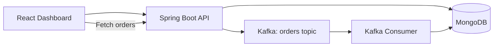

# Order Processing System

A full-stack learning project exploring event-driven order processing using Spring Boot, Apache Kafka, and MongoDB.

## Tech Stack

- **Frontend**: React, Vite, Tailwind CSS
- **Backend**: Java 20, Spring Boot, Maven
- **Messaging**: Apache Kafka (with Zookeeper)
- **Database**: MongoDB
- **Infrastructure**: Docker Compose

## How It Works

1. Create an order through the React dashboard.
2. Spring Boot saves the order in MongoDB with `RECEIVED` status.
3. The backend publishes an `OrderCreatedEvent` to Kafka.
4. A Kafka consumer processes the event and updates the order status.
5. The dashboard refreshes to show the status: `RECEIVED` → `PROCESSING` → `PROCESSED`.

## Architecture



## Getting Started

### Prerequisites

- Java 20
- Node.js and npm
- Docker Desktop with Docker Compose

### 1. Start Kafka and MongoDB

From the project root:

```bash
docker compose up -d
docker compose ps
```

### 2. Run the backend

Open a terminal:

```bash
cd backend
mvn spring-boot:run
```

Alternatively, import the backend folder into Eclipse as an existing Maven project and run the Spring Boot main class.

Backend: http://localhost:8080

### 3. Run the frontend

Open another terminal:

```bash
cd frontend
npm install
npm run dev
```

Open the local URL printed by Vite, usually http://localhost:5173.

## API Endpoints

| Method | Endpoint | Description |
|--------|----------|-------------|
| POST | `/api/orders` | Create an order |
| GET | `/api/orders` | Get all orders |
| GET | `/api/orders/{id}` | Get an order by ID |

**Example request:**

```bash
curl -X POST http://localhost:8080/api/orders \
  -H "Content-Type: application/json" \
  -d '{"product":"Laptop","quantity":2}'
```

## Learning Goals

- Build REST APIs with Spring Boot
- Store data using Spring Data MongoDB
- Publish and consume events with Kafka
- Understand asynchronous processing and event-driven architecture

---

**Note**: This project is for learning and experimentation, not production use.
